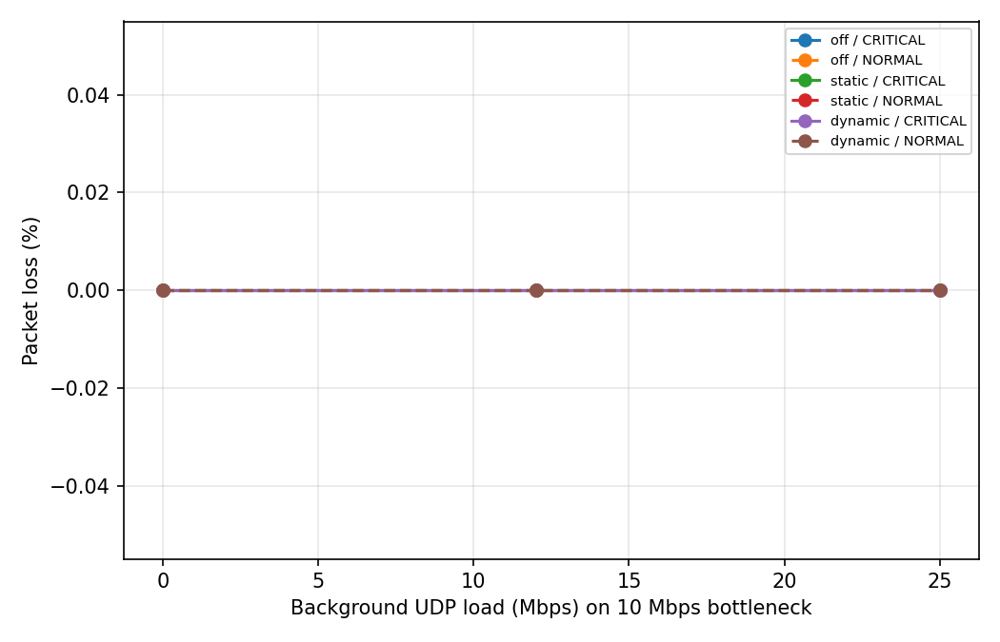
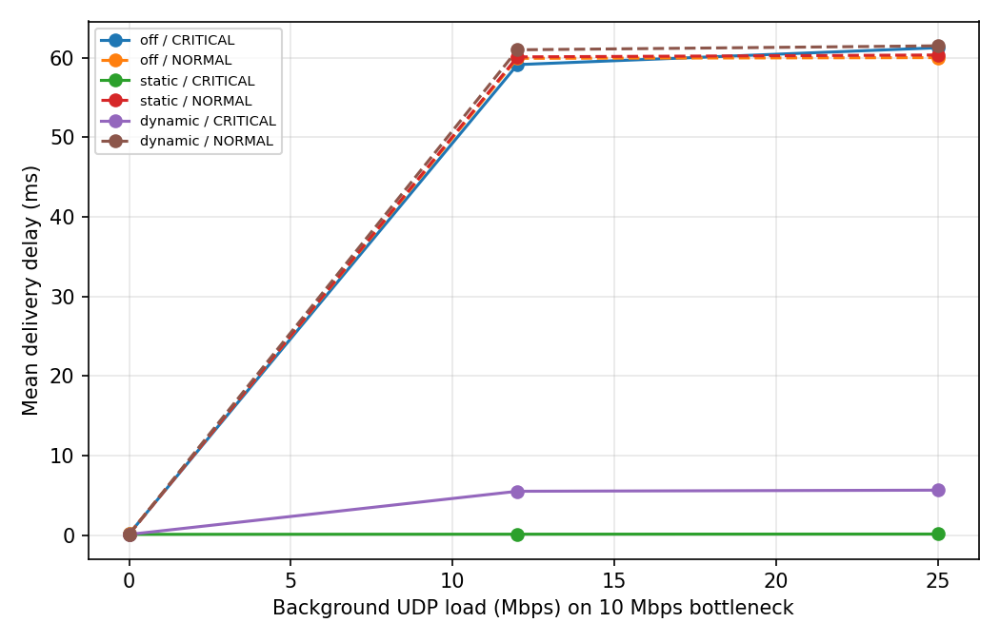

# LogShield: Priority-Aware UDP Log Aggregation over SDN

**Computer Networks mini project (SDN + Socket Programming), Project 10: Distributed Log Aggregation System**
PES University, Dept. of CSE

> Team:'10'
> SRNs: 'PES1UG25AM539 PES1UG25AM561 PES1UG25AM526'

UDP log clients send severity-tagged, timestamped, sequence-numbered logs to a central log server inside a
Mininet network. A Ryu (OpenFlow 1.3) controller watches the server-facing link and, when it becomes congested,
dynamically installs a flow rule that moves CRITICAL logs into a guaranteed-bandwidth queue. The project measures
packet loss and delivery time with prioritization **off** (baseline), **static** and **dynamic** (proposed).

---

## 1. Problem and objectives

Hosts in a network send application logs to one central server. Under congestion, important logs (CRITICAL) compete
with bulk traffic and can be delayed or lost. Objectives:

1. Implement a UDP log client and a central log server using low-level sockets.
2. Run them in a Mininet topology controlled by an SDN controller.
3. Let the application's traffic class (CRITICAL vs. other logs) influence SDN behaviour.
4. Detect congestion and prioritize CRITICAL logs dynamically.
5. Evaluate against a baseline under multiple load conditions.

## 2. Architecture

```
 h2 (log client) --\
 h3 (log client) ---+-- s1 (Open vSwitch, OF1.3) --[s1-eth1: 10 Mbps HTB]-- h1 (log server)
 h4 (iperf UDP noise) -/        |                    queue 0: normal
                                |                    queue 1: critical (6 Mbps guaranteed)
                        Ryu controller (port + flow stats every 1 s)
```

| Component | Role |
|---|---|
| h1 | Central log server (UDP 9998 and 9999) and iperf sink |
| h2, h3 | Log clients |
| h4 | Congestion generator (iperf UDP, 0 / 12 / 25 Mbps) |
| s1 | Open vSwitch with OpenFlow 1.3 and QoS queues on the link to h1 |
| Controller | Ryu app: learning switch, flow and port statistics, dynamic priority rule |

**Communication flow**

1. A client generates a log with a severity (INFO, WARNING, ERROR, CRITICAL), a sequence number and a send timestamp.
2. Normal logs go to UDP port **9998**. CRITICAL logs go to UDP port **9999**.
3. The server writes every log to `aggregated.log` and every packet's timing to `recv.csv`.
4. The controller polls port and flow statistics on s1 every second and computes link utilization.
5. When utilization is high, the controller installs a rule that sends UDP 9999 traffic into the critical queue.
   When utilization is low again, it removes the rule.

## 3. Socket implementation (UDP)

- **Server (`server.py`)**: listens on two UDP ports (9998, 9999), records severity, sender, sequence number and
  receive time, counts logs per severity, and counts malformed datagrams instead of crashing on them. Output files:
  `aggregated.log` (human-readable, categorised by severity) and `recv.csv`
  (`client,seq,sev,port,ts_sent,ts_recv,delay_ms`).
- **Client (`log_client.py`)**: sends logs at a configurable rate and severity mix.

  | Option | Meaning |
  |---|---|
  | `--id` | client name |
  | `--server` | server IP (default 10.0.0.1) |
  | `--count` | number of logs to send |
  | `--rate` | messages per second |
  | `--critical-ratio` | fraction of logs that are CRITICAL |
  | `--out` | output folder (writes `sent_<ip>.csv`, used to compute loss) |
  | `--seed` | random seed for repeatable runs |

- **Why UDP**: logs are small and frequent, and UDP avoids connection setup and retransmission delay. Loss is
  therefore possible, which is exactly what the evaluation measures (sequence numbers show what was lost).

## 4. Mininet and SDN implementation

- **Topology** (`run_experiment.py`): 4 hosts and one OpenFlow 1.3 switch. The link s1-eth1 to h1 is limited to
  10 Mbps (HTB) with two queues set up by `setup_qos()`: queue 0 (normal) and queue 1 (critical, 6 Mbps guaranteed).
- **Controller (`controller.py`)**:
  - Learning switch: priority-0 table-miss rule sends unknown packets to the controller, then priority-1 rules
    forward known host-to-host traffic.
  - Statistics: port and flow stats polled every 1 s. The measured transmit rate on the server-facing port gives
    `util = rate / link capacity`.
  - Priority rule: a flow entry that matches UDP port 9999 and sends it to queue 1.
  - Event log: `controller_logs/controller_events.log` records `PRIORITY ON` / `PRIORITY OFF` with the reason.
  - A per-poll CSV records time, mode, rate, utilization and priority state.

### Controller modes

Selected through the file `/tmp/prio_mode`:

| Mode | Behaviour |
|---|---|
| `off` | Priority never installed (baseline) |
| `static` | Priority rule always installed |
| `dynamic` | **Proposed.** Install rule when utilization >= 80% of 10 Mbps. Remove it after utilization stays below 40% for 3 consecutive polls |

The gap between the 80% and 40% thresholds (hysteresis) and the 3-poll delay stop the rule flapping on and off.

## 5. Socket and SDN integration

The application marks its own traffic classes by port: CRITICAL logs use UDP 9999 and everything else uses 9998.
The controller uses that port number as the match field for the priority rule, so the application's traffic class
directly decides which queue a packet gets. Congestion measured by the controller decides *when* that rule is
installed. Together, application behaviour and network state both shape the forwarding decision.

## 6. Repository contents

| Path | Purpose |
|---|---|
| `server.py` | UDP log server (two ports), writes `aggregated.log` and `recv.csv` |
| `log_client.py` | UDP log client with severity, timestamp and sequence number |
| `controller.py` | Ryu controller: learning switch, stats polling, dynamic priority rule |
| `run_experiment.py` | Mininet topology, OVS QoS queues, automated trials, manual-demo CLI |
| `analyze.py` | Computes loss and delay, writes `summary.csv`, `loss.png`, `delay.png` |
| `results/` | Raw data, `summary.csv` and graphs |
| `controller_logs/` | Controller event log and per-poll statistics |

## 7. Setup (Ubuntu 20.04 / 22.04 VM)

System packages:
```bash
sudo apt install mininet openvswitch-switch iperf python3-pip -y
```

Ryu needs an older Python and pinned versions, so use a virtual environment:
```bash
uv venv --python 3.9 ~/ryuenv
source ~/ryuenv/bin/activate
uv pip install --no-build-isolation "ryu==4.34" "eventlet==0.30.2"
```
`analyze.py` needs `matplotlib` (`pip3 install matplotlib`).

## 8. How to run

Open two terminals. Start the controller first.

**Terminal 1: controller**
```bash
cd logshield-sdn
source ~/ryuenv/bin/activate
ryu-manager --ofp-tcp-listen-port 6653 controller.py
```

**Terminal 2: automated experiments (about 7 minutes) and analysis**
```bash
cd logshield-sdn
sudo mn -c
sudo python3 run_experiment.py
python3 analyze.py
```
`analyze.py` prints the results table and writes `results/summary.csv`, `results/loss.png` and `results/delay.png`.

### Manual demo

Set the controller mode (Terminal 3):
```bash
echo dynamic | sudo tee /tmp/prio_mode
```

Start the CLI (Terminal 2):
```bash
sudo mn -c
sudo python3 run_experiment.py --cli
```

At the `mininet>` prompt:
```
pingall
sh ovs-ofctl -O OpenFlow13 dump-flows s1
sh mkdir -p results/demo
h1 python3 server.py --out results/demo --duration 60 &
h1 iperf -u -s > /dev/null 2>&1 &
h2 python3 log_client.py --id h2 --count 3000 --out results/demo &
h3 python3 log_client.py --id h3 --count 3000 --out results/demo &
h4 iperf -u -c 10.0.0.1 -b 25M -t 20 &
```
Watch the priority events (Terminal 3):
```bash
tail -f controller_logs/controller_events.log
```
You should see `PRIORITY ON` shortly after the noise starts and `PRIORITY OFF` a few seconds after it ends.

## 9. Test cases

| # | Test | Expected result |
|---|---|---|
| T1 | `pingall` after startup | 0% dropped, all hosts reach each other through the controller |
| T2 | Flow table after traffic (`dump-flows`) | Priority-0 rule to controller and priority-1 forwarding rules |
| T3 | One client sends logs, no congestion | All logs in `aggregated.log`, delay well under 1 ms |
| T4 | Two clients (h2, h3) send together | Logs from both senders appear in `aggregated.log` |
| T5 | Dynamic mode with 25 Mbps noise | `PRIORITY ON` appears, then `PRIORITY OFF` after the noise ends |
| T6 | 3 modes x 3 loads (0, 12, 25 Mbps) | 9 trials; loss and delay compared with the `off` baseline |

Functional baseline observed with one client, 1000 logs and no congestion: all logs were collected, with
per-packet delivery delay of roughly 0.06 to 0.3 ms. CRITICAL logs arrived on port 9999 and all others on 9998.

## 10. Evaluation

**Metrics**

- Packet loss = (sent - received) / sent, per traffic class, using the client sequence numbers.
- Delivery time = server receive time - client send time (all hosts share the VM clock).

**Baseline**: prioritization `off`, compared against `static` and `dynamic`.

**Challenging scenario**: congestion. The background load (12 and 25 Mbps) exceeds or approaches the 10 Mbps link.
Each 30-second run starts the noise 5 seconds in, so the reaction time of dynamic mode shows up as a short
window of loss or delay for CRITICAL logs.

### Results

Source: `results/summary.csv` (produced by `analyze.py`). Packet loss was **0.0%** for both traffic classes in all
18 rows (3 modes x 3 loads x 2 classes), so the differences show up in delivery delay.

| Load (Mbps) | Mode | CRITICAL mean delay (ms) | CRITICAL p95 (ms) | NORMAL mean delay (ms) |
|---|---|---|---|---|
| 0 | off | 0.17 | 0.29 | 0.17 |
| 0 | static | 0.13 | 0.25 | 0.13 |
| 0 | dynamic | 0.12 | 0.24 | 0.12 |
| 12 | off | 59.12 | 114.08 | 59.91 |
| 12 | static | 0.15 | 0.33 | 60.09 |
| 12 | dynamic | 5.54 | 66.74 | 60.98 |
| 25 | off | 61.24 | 115.45 | 60.00 |
| 25 | static | 0.17 | 0.29 | 60.33 |
| 25 | dynamic | 5.68 | 69.55 | 61.48 |




### Discussion

Without congestion (0 Mbps) all three modes deliver logs in about 0.1 to 0.2 ms, so prioritization costs nothing
when the link is idle. Under 12 and 25 Mbps of background UDP and with prioritization **off**, CRITICAL logs wait
in the same queue as the noise and see about 59 to 61 ms mean delay (p95 about 114 ms), the same as normal logs.
With **static** priority the CRITICAL logs bypass that queue and drop to about 0.15 to 0.17 ms (about 99.7% lower),
while NORMAL logs stay at about 60 ms, so the benefit for critical logs does not cost normal logs anything
measurable. The proposed **dynamic** mode cuts CRITICAL mean delay by about 90% (59.12 to 5.54 ms at 12 Mbps and
61.24 to 5.68 ms at 25 Mbps). It is not as good as static because the controller polls once per second and installs
the rule only after utilization reaches 80%, so CRITICAL logs sent in the first moments of congestion still queue
(visible in the p95 of about 67 to 70 ms); once the rule is installed they are delivered in well under a
millisecond. Packet loss was 0% in every trial: in this emulated setup the 10 Mbps queue buffers the excess traffic
instead of dropping it, so congestion appears as queueing delay rather than loss.

## 11. Limitations and future work

- A single bottleneck link and a shared VM clock, so the setup is simpler than a real network.
- Dynamic mode reacts only after utilization crosses the threshold, so there is a short delay before critical logs
  are protected.
- Possible extensions: a link-failure or server-overload test with rerouting, per-severity queues (not just
  CRITICAL vs. rest), and TCP-based log delivery for comparison.

## 12. Troubleshooting

| Problem | Fix |
|---|---|
| `ryu-manager: command not found` | Run `source ~/ryuenv/bin/activate` first |
| Mininet waits for the switch / "waiting for switches" | Start the controller first and check it listens on 6653: `sudo ss -ltnp \| grep 6653` |
| `OSError: [Errno 98] Address already in use` | `sudo pkill -f server.py` and `sudo mn -c` |
| `dpctl dump-flows` shows a version error | Use `sh ovs-ofctl -O OpenFlow13 dump-flows s1` |
| `PRIORITY ON` never appears | Check the mode with `cat /tmp/prio_mode` and set `dynamic` |
| Log files empty after a demo | The server writes its files when it stops: wait for `--duration` to end or `sh pkill -f "[s]erver.py"` |
